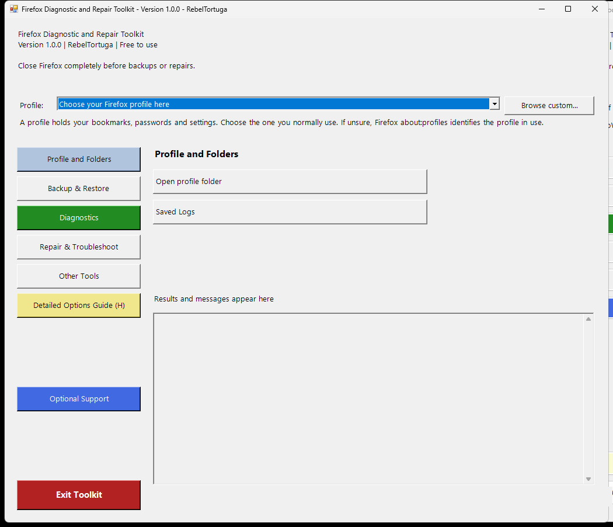

# Firefox Diagnostic and Repair Toolkit
## Open the sidebar version
Extract this ZIP into a **new folder**, then double-click **Firefox Diagnostic and Repair Toolkit.bat** in that folder. The title bar shows **1.0.0**. This version has clickable section buttons on the left, actions on the right, a results area, and a highlighted Exit Toolkit button beneath the sidebar. Use this launcher rather than a shortcut to an earlier extracted release. The backup category picker remains a separate dialog.

**Developer:** RebelTortuga  
**Platform:** Windows 10 / Windows 11  
**Version:** 1.0.0  
**Cost:** Free to use. No payment is required.

A Firefox companion to the WoW Diagnostic and Repair Toolkit: a clickable section sidebar, Diagnostics Center, backup and restore, separate repair actions, saved logs, and detailed help. Independent utility; not affiliated with Mozilla.

## Screenshot

## Start here
1. Extract **all files** from the ZIP into one folder.
2. Double-click **Firefox Diagnostic and Repair Toolkit.bat**.
3. Choose your Firefox profile from the **Profile** list at the top. Standard and registered profiles are detected automatically; use **Browse custom...** only for a custom location. In Firefox, `about:profiles` lists its Root Directory. Close Firefox after checking it.
4. Click **Diagnostics → Quick health check** and review the findings in the results area.
5. Click **Backup & Restore → Save a backup**; select individual categories or Select all.

The launcher opens the graphical toolkit and hides the console window. Keep the main toolkit open for section navigation, action buttons, confirmations and results. Backup/restore opens dialogs from a hidden process; the main toolkit waits and remains open without an extra console window. Completely exit Firefox when instructed, including background processes. Click the highlighted **Exit Toolkit** button at the bottom left when finished. Windows PowerShell 5.1 is included with Windows 10 and 11. PowerShell 7, Git, Python and administrator access are not required. Execution-policy bypass applies only to the launched process; it does not change system policy. Download blocking guidance is in RUN-README.md.

## Menu
| Button or section | Actions / appearance |
| --- | --- |
| Profile and Folders | Choose profile from the top dropdown; open profile folder; saved logs |
| Backup & Restore | Save a backup; restore a backup |
| Diagnostics | Green button; quick health check; full local scan; export last report |
| Repair & Troubleshoot | Troubleshoot Mode; startup-cache repair; guided Refresh; clean test profile |
| Other Tools | about:support; verify backup; feedback; Mozilla guidance |
| Detailed Options Guide (H) | Yellow button below Other Tools; opens the detailed guide |
| Optional Support | Blue button; optional Ko-fi support with confirmation |
| Exit Toolkit | Red button with white text; closes the toolkit |

The graphical interface has a section sidebar on the left, action buttons on the right, and a results area beneath them. See [OPTIONS-README.md](OPTIONS-README.md) for effects and limitations.

## Backup choices
Bookmarks (latest automatic snapshot), saved passwords, installed extensions and their data, and browser settings. **All means these four categories, not the entire profile.** History, cookies, website storage, cache and open tabs are excluded. Extensions also include prefs.js, which can roll back unrelated browser preferences. Settings-only backup means prefs.js, not every customization. Password files contain sensitive information. Backups are not encrypted. Bookmarks can miss recent edits; export a fresh bookmark JSON in Firefox when needed. Bookmarks are imported separately after restore, replacing existing bookmarks. Password files and preferences are replaced, not merged.

Additional extensions can remain because restore overlays files.

## Diagnostics and repair limits
PASS / WARN / FAIL / INFO / UNKNOWN describe local findings, not a guaranteed diagnosis. Scans inspect files, JSON parsing, running processes, free disk space and bookmark snapshots. They do not verify SQLite databases, detect malware or prove extensions are compatible. Reports are exported only when requested to a location you choose. Review local paths before sharing. Startup-cache repair preserves a recovery copy and requires a confirmation dialog. Refresh is guided: this toolkit opens Firefox's own page, and the user initiates and confirms Refresh there. Troubleshoot Mode and Profile Manager are launch actions, not automatic repairs. Firefox can write to its profile after launch.

## Settings and logs
Saved profile selection: `%LOCALAPPDATA%\RebelTortuga\Firefox-Toolkit\settings.json`. Session logs: `%LOCALAPPDATA%\RebelTortuga\Firefox-Toolkit\Logs`. Startup-cache recovery: `%LOCALAPPDATA%\RebelTortuga\Firefox-Toolkit\Recovery`. Profile restore recovery folders are created beside the target profile. Never delete recovery data until you have checked Firefox. The results area starts with the current log filename. Logs may contain identifying paths; inspect before sharing. No passwords or login contents are intentionally logged.

## Release status

It will not collect payment information or make a payment; any contribution would be completed separately on Ko-fi. Bug reports, improvement ideas, and sharing the project are welcome ways to help as well.

## Feedback
Use this repository's Issues tab for bugs, cleanup suggestions and feature requests. Include Windows/Firefox versions, option selected, reproduction steps and exact error text. Never attach passwords, profiles or backups. This repository is the official RebelTortuga project page for this independent toolkit.

## Mozilla references
- [Troubleshoot and diagnose Firefox problems](https://support.mozilla.org/en-US/kb/troubleshoot-and-diagnose-firefox-problems)
- [Troubleshoot Mode](https://support.mozilla.org/en-US/kb/diagnose-firefox-issues-using-troubleshoot-mode)
- [Firefox command-line options](https://wiki.mozilla.org/Firefox/CommandLineOptions)

## Finding Exit
**Exit Toolkit** is highlighted at the bottom left. **Detailed Options Guide** is directly below **Other Tools**, and **Optional Support** sits between the guide and Exit with equal spacer rows above and below. The standard window Close button is also available. Click **Exit Toolkit** to close the main toolkit. Exit is disabled while an operation is running; wait for the operation to return.

## Section sidebar interface
Click a section on the left to display its actions on the right. Diagnostic findings and action messages appear in the results area below the buttons. Backup and restore keep their category-selection dialogs. Numbered documentation sections still identify the tools, but you now click buttons instead of entering menu numbers. Repair and support-link confirmations use dialogs. The interface can pause while an operation runs; background progress and cancellation are not implemented. Do not force-close it while files are being copied.

## Hidden-console launcher
Double-click **Firefox Diagnostic and Repair Toolkit.bat** or **Launch-Toolkit.vbs**. Both use Windows Script Host to launch PowerShell hidden; only the graphical toolkit stays visible. Keep the VBS, BAT and both PS1 files together. Do not run the PS1 directly if you want the console hidden. Windows Script Host must be available; if organizational policy disables it, contact your administrator.

## Button order and colors
The left-side buttons appear in this order:
1. **Profile and Folders**
2. **Backup & Restore**
3. **Diagnostics** — green
4. **Repair & Troubleshoot**
5. **Other Tools**
6. **Detailed Options Guide (H)** — yellow
7. **Optional Support** — blue
8. **Exit Toolkit** — red with white text

The guide is directly below Other Tools. Optional Support remains evenly positioned between the guide and Exit. These button colors remain in place when switching sections. The toolkit starts on Profile and Folders. Version remains **1.0.0**.

## Frequently asked questions and troubleshooting

**Which Firefox profile should I choose?** In Firefox, visit `about:profiles` and compare the Root Directory to the profile shown in the toolkit. Close Firefox before backup or repair operations.

**The window or buttons look different from the screenshots.** Extract the latest release into a **new folder** and launch `Firefox Diagnostic and Repair Toolkit.bat` there. An older desktop shortcut can point to a previous copy.

**Will a backup include everything?** You choose the backup categories. Review the selection, verify the resulting backup, and keep a separate copy before modifying your browser profile.

**Why does Firefox need to be closed?** Files can be in use or change during backup and repair. Fully exit Firefox, including background processes, when the action instructs you to.

**Does this require administrator access or PowerShell 7?** No. The documented launcher uses Windows PowerShell 5.1, which is included with Windows 10 and 11.

## 🔗 Related Free RebelTortuga Projects

Explore other free tools and workflows:

- [wow-diagnostic-and-repair-toolkit](https://github.com/RebelTortuga/wow-diagnostic-and-repair-toolkit)
- [brave-diagnostic-and-repair-toolkit](https://github.com/RebelTortuga/brave-diagnostic-and-repair-toolkit)
- [shell-diagnostic-and-repair-toolkit](https://github.com/RebelTortuga/shell-diagnostic-and-repair-toolkit)

[Browse all RebelTortuga projects](https://github.com/RebelTortuga)

## 🐢 Support RebelTortuga

All features are free. A donation is never required and does not unlock anything.

**[☕ Help this turtle get a new shell on Ko-fi!](https://ko-fi.com/rebeltortuga)**

The in-app **Optional Support** button asks before opening the same page in your browser. The toolkit does not collect payment information.

## License

MIT; see [LICENSE](LICENSE). This independent toolkit is not affiliated with Mozilla.

---

<!-- BEGIN REBELTORTUGA SAFETY -->
## Privacy & Software Safety

Read the [project safety guidance](SAFETY.md) before use. It covers permissions, backups, recovery, local files, and security warnings. See [SECURITY.md](SECURITY.md) for vulnerability reporting and the [license](LICENSE) for terms.

[Privacy & Software Safety](https://rebeltortuga.github.io/privacy-software-safety.html) · [Project Licenses](https://rebeltortuga.github.io/project-licenses.html)

Do not upload passwords, access tokens, browser profiles, private backups, or unredacted diagnostic reports to public issues.
<!-- END REBELTORTUGA SAFETY -->

## Connect with RebelTortuga

- [YouTube](https://www.youtube.com/@RebelTortuga)
- [Twitch](https://www.twitch.tv/rebeltortuga)
